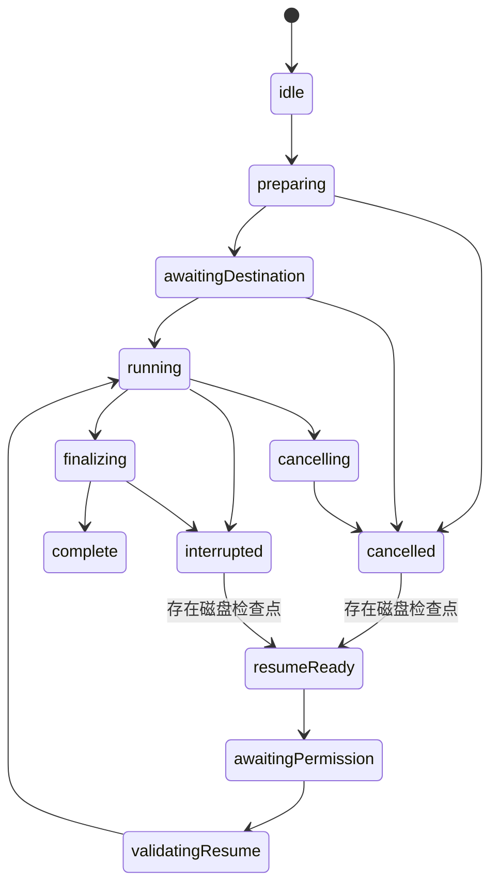

# 3600 秒透明 PNG 序列导出 · 实施任务规格

日期：2026-11-03
状态：实施中（2026-11-04 起由 long-png-export 任务执行）；本文是实现与验收契约，长任务验证完成前不表示功能已可用。
范围：PNG 导出链路、必要的交互与恢复、相关文案及契约测试。本规格不授权生产部署或客户联系。

## 1. 目标与已确定的产品决策

将 Pro 的 PNG 序列时长上限从 600 秒提升到 3600 秒，让桌面 Chrome 能实际生成完整、透明、可导入剪辑软件的 PNG 序列。

必须满足：

1. 透明背景、模板、倒计时、帧率、分辨率和用户样式保持用户选择；不得暗中降为 1fps、缩小画布、改变模板或切换视频格式。
2. 正常短任务尽量保持“点击导出 → 得到一个 ZIP”的体验；长任务增加一次准备步骤，选择保存位置并说明多卷解压方式。
3. 长任务逐帧编码、流式写盘，不累计整个 ZIP 或所有分卷的字节。
4. 输出多个独立可解压的普通 ZIP；不是 `.z01/.z02` 分盘压缩包。所有卷解压合并后是一条连续图片序列。
5. 优先保障桌面 Chrome。Safari 大任务建议切换桌面 Chrome；移动端大任务建议使用电脑。建议弹窗与实际能力拦截分离，不能用浏览器名称代替能力检测。
6. 完成卷可保留；取消、刷新或 worker 异常后，支持验证检查点并从最后一个完整卷之后继续，最多重做当前未完成卷。
7. 免费时长仍为 300 秒，Pro 为 3600 秒；现有帧率、模板和分辨率权益不变。
8. 不新增服务端渲染、不上传图片或字体、不改支付/退款/身份识别流程，不给客户发送消息。

首要完整验收场景是桌面 Chrome、1280×720、30fps、透明背景、3600 秒。其他已有可选设置不能被悄悄移除，但 4K/60fps 必须独立验证，不得由 720p 成功推导性能承诺。

## 2. 当前实现与必须修正的集成点

以下是本次阅读代码得到的事实：

| 位置 | 当前行为 | 本次要求 |
|---|---|---|
| `src/lib/pro/entitlements.ts` | `PRO_MAX_DURATION_SECONDS=3600`，另有 PNG 600 秒上限 | PNG 改为使用统一权益时长；600 只作为长任务交互阈值，删除旧硬拦截含义 |
| `src/lib/generator/feature-detection.ts` | PNG 超过 600 秒返回 `pngSequenceTooLongError`；移动端非 MP4 共用硬限制 | 移除 PNG 600 秒硬拦截；PNG 使用本规格的建议与能力判定；其他格式规则不变 |
| `src/workers/generator-export.worker.ts` | PNG 使用 `ZipPassThrough`，输出块全部累计在 `chunks`，最后创建 Blob | 流式输出、按字节和条目数分卷、有背压、完成卷提交后再推进检查点 |
| `src/lib/generator/export/job.ts` | 完成消息只包含一个 Blob；文件名为至少四位补零的一基编号 | 扩展 PNG 专属协议；统一固定宽度文件名；保留其他格式单文件契约 |
| `src/components/generator/generator-shell.tsx` | 完成时终止 worker、验证一个 Blob、自动下载；取消直接终止 worker | 支持目录完成/OPFS 多卷完成；PNG 协作取消及异常后恢复；不破坏其他格式 |
| `src/components/generator/export-panel.tsx` | 错误会禁用按钮，但缺少 PNG 过长错误的专用文案映射 | 所有新阻断原因有明确本地化解释；建议不能伪装成错误 |
| `src/lib/generator/export/artifact.ts` | 只读取前 12 字节检查签名 | 保留有限读取；PNG 分卷新增尾部、目录与条目范围校验，不能整卷读入内存 |
| `src/lib/generator/export/prores-bundle.ts` | 每包带转换脚本，引用 `frame-%04d.png` | 同步序列宽度、一基起点和多卷合并说明；避免每卷都出现可误执行的完整转换脚本 |
| `src/lib/generator/encode/mp4-sink.ts` | 已有 worker OPFS 同步写、短写检查和存储错误处理 | 借鉴局部模式；不要照搬按前缀删除旧导出的清理方式，不能误删仍可恢复的 PNG 任务 |

依赖 `fflate@0.8.2` 的当前 `Zip` 实现保留每个条目的目录元数据，结束时分配中央目录；输出回调是同步回调，返回 Promise 不会让 ZIP 库等待写盘。不能写一个 `async ondata` 就声称已经实现背压。

传统 ZIP 存在 65,535 条目及约 4 GiB 字段边界。3600 秒在 24/30/60fps 下分别有 86,400 / 108,000 / 216,000 帧。本次采用有上限的独立 ZIP，避免依赖尚未验证的 ZIP64 写入能力。

## 3. 非目标与不可宣称的能力

- 不实现单个超大 ZIP64 文件，也不提供单独散落十万 PNG 的默认输出路径。
- 不保证某个固定导出耗时、不保证手机锁屏或电脑休眠期间持续执行。
- 不自动跨设备、跨浏览器迁移未完成任务；本地检查点不是云同步。
- 不恢复半写入 ZIP 的内部编码状态；恢复粒度是完整卷。
- 不提供撤销任意用户文件、自动覆盖已有输出或删除用户目录的操作。
- 不以本次历史单个导出数据推断所有设备速度；预估与实测分别展示。
- 不因当前只重点保障 Chrome 而声称 Safari 的透明视频替代路径已经验证。

## 4. 输出路径与平台策略

### 4.1 判定输入

使用冻结的导出配置计算：

- `totalFrames = max(1, round(durationSeconds * fps))`，与现有语义一致。
- `canvasPixels = width * height`。
- `pixelFrames = canvasPixels * totalFrames`。
- 抽样得到的 `estimatedArchiveBytes`、`estimatedElapsedMs`，未取得可靠样本时标记未知，不填假数字。

每个任务保存一份配置快照；导出开始后 UI 调整不得污染正在运行的任务。

### 4.2 确定的初始阈值

| 常量含义 | 初始值 | 用途 |
|---|---:|---|
| 长任务时长阈值 | `durationSeconds > 600` | 长导出准备流程，不是时长上限 |
| 每卷 PNG 数量上限 | 10,000 | 限制 ZIP 条目数及目录元数据 |
| 每卷完整 ZIP 字节上限 | 512 MiB，即 `512 * 1024 * 1024` | 包含头部、PNG、描述符、目录、说明文件和 EOCD |
| 无可用磁盘时的短任务内存总字节上限 | 128 MiB | 严格有限的兼容路径；长任务禁用该回退 |
| 桌面额外大任务条件 | `pixelFrames >= 4_000_000_000` 或 `canvasPixels >= 4_000_000` | 复用当前大任务量级，用于预检与建议 |
| 移动端建议条件 | `durationSeconds > 60` 或 `canvasPixels > 1920 * 1080` 或 `pixelFrames > 1_900_000_000` | 将 PNG 的旧移动端限制转为导出时建议；其他格式不变 |

进入长任务流程：时长超过 600 秒，或总帧数超过 10,000，或估算 ZIP 超过 512 MiB。桌面额外大任务条件要求预检，但若最终仍为短任务且能单卷保存，不强制增加目录选择。

抽样低估导致运行时产生多卷时，仍必须正确切卷；OPFS 完成页显示实际卷数与下载列表，不能继续假装是一个 ZIP。准备提示应说明卷数为估算。

### 4.3 路由优先级

| 场景 | 输出方式 | 行为 |
|---|---|---|
| 桌面 Chrome/其他具备目录写权限能力的桌面浏览器，长任务 | 用户选择目录，worker 逐卷写入 | 默认推荐；只在主线程用户手势中调用目录选择器 |
| 目录选择器不可用，或用户明确选择浏览器临时保存；OPFS 实际可写 | worker OPFS 逐卷写入 | 完成卷可逐卷下载；长任务必须先告知空间和下载方式 |
| 普通短任务，OPFS 可写 | OPFS 单卷或按实际大小分卷 | 通常完成后自动请求下载一个 ZIP；不增加长任务弹窗 |
| 短任务，OPFS 不可写 | 受 128 MiB 总上限约束的内存单卷 | 超限给出明确错误与换桌面 Chrome建议；禁止无限累积 |
| 长任务，没有可写目录且 OPFS 不可写 | 不开始编码 | 清晰说明无法安全保存长导出；不自动改 MP4、不降设置 |

取消目录选择器视为取消准备，不记为导出失败，也不静默切换 OPFS。

桌面 Chrome 可直接写用户目录，并不代表能通过 `navigator.storage.estimate()` 得知该磁盘剩余空间。该 API 只用于 origin 存储配额估计；直接目录模式只能显示预计所需空间，运行中处理写入/关闭错误。`createWritable()` 可能使用临时文件，不能承诺零额外磁盘占用。

### 4.4 Safari 与移动端建议

- 桌面 Safari：满足长任务或桌面额外大任务条件时，建议“为了更好的导出性能，建议使用电脑端 Chrome”。
- 移动端/平板：满足移动端建议条件时，建议“为了更好的导出性能，建议在电脑端导出”。iOS Chrome 不视为桌面 Chrome。
- 建议弹窗在点击导出后出现，不在输入时长或页面加载时反复弹出；一次准备流程只显示一次，采样完成后不重复叠窗。
- 能力探测通过时允许用户选择继续；长任务依然只能走磁盘路径。没有安全输出能力时显示具体原因，继续按钮不可用。
- 非 Chrome 的成功仅代表该设备当前能力通过；本次不宣称所有移动端一小时输出有稳定性保障。
- 移动端 PNG 不再因为旧 60 秒规则直接静默禁用导出；其他格式的移动端规则保持不变。

## 5. 用户交互契约

### 5.1 短任务

保留设置、预览、Export 按钮和单 ZIP 自动下载体验。正常短任务不强制目录选择、不展示技术名词、不让用户理解 OPFS 或 ZIP 中央目录。

### 5.2 长任务准备

点击 Export 后冻结设置并显示准备面板：

1. 先展示确切的时长、帧率、帧数和分辨率。
2. 使用同一渲染代码和字体，在 worker 中最多采样 12 个分散时间点，包括开始、中间、末尾与可用的连续变化片段；不逐次启动大量 worker。
3. 得到平均帧字节数和耗时后，显示近似容量、卷数和耗时，明确它们会随实际输出更新；样本不能保证最坏帧大小。
4. 说明长任务将保存多个 ZIP，以及“全部解压后，把所有 `frame-*.png` 放到同一目录，再以图片序列导入”。
5. 默认按钮“选择保存文件夹并开始”。完成采样后由用户再次点击，立即在此手势内调用 `showDirectoryPicker({mode: 'readwrite'})`；不能先 await 网络/采样再尝试使用已经过期的用户激活。
6. OPFS 模式按钮“在浏览器中生成，完成后逐卷下载”；明确可能需要同时容纳临时文件、下载副本和解压结果。
7. 取消准备恢复空闲，不写输出、不改变用户设置、不触发付费以外的新权益规则。

### 5.3 进行中

- 展示全局帧进度、估计剩余时间、当前卷号、已保存/已生成卷数和实际字节数。
- “已处理帧”与“已经安全保存的帧”分开统计；当前卷未关闭不能算作可恢复成果。
- 只在全部帧、最后一卷关闭及任务清单提交完成后达到 100% 成功。
- 沿用现有低频数值进度、缩略预览和 wake lock；记录模式要让写盘、结束 ZIP、校验、提交检查点等阶段可见。
- 长任务不要每帧更新 React state，也不要不断增加主线程 Blob、ArrayBuffer 或 ImageBitmap 引用。
- 保留取消按钮；点击后立即变为“正在停止”，不会开始第二个任务。

### 5.4 完成与多卷解压

目录模式：显示任务子目录名、实际卷数及“文件已保存”；浏览器没有打开系统文件管理器能力时，不做虚假的“打开文件夹”按钮。

OPFS 模式：显示各卷文件名、大小、帧范围和独立下载按钮。禁止对多卷默认循环调用自动下载。短任务单卷可继续自动请求下载。

成功区和随包说明必须明确：

- 所有 ZIP 都需要解压，每卷只包含完整序列的一部分。
- 一些解压工具会按 ZIP 名分别创建文件夹；将这些文件夹中的 `frame-*.png` 合并到一个 `frames` 文件夹，文件名不冲突。
- 不要把每一卷当成独立倒计时，不要分别按从 00:00 开始导入。
- 在剪辑软件中按本次选择的 fps 导入整个 PNG 序列。
- 转换 ProRes 前先确认所有卷已解压合并；脚本检测缺帧并拒绝输出悄悄截短的视频。

提示至少提供中文和英文经校对的完整语义，实际 UI 必须覆盖所有 `enabledLocales`（当前 17 种），包括西班牙语；不允许新错误退回无关的通用提示。

## 6. 文件布局、命名与时间连续性

### 6.1 输出目录

直接目录模式在用户所选目录内创建独占任务子目录，例如：

```text
time-overlay-<jobId>/
  manifest.json
  EXPORT-INSTRUCTIONS.txt
  convert-to-prores.sh
  convert-to-prores.bat
  README-prores.txt
  timer-part-001.zip
  timer-part-002.zip
  ...
```

创建时验证不存在同名任务目录；碰撞则生成新 ID，不覆盖。只删除本任务清单明确标记为未提交的文件，绝不按宽泛前缀清理用户目录。

OPFS 使用独立命名空间 `time-overlay-png/<jobId>/`，不能与 MP4 清理前缀重叠。检查点与用户字体都保持本地。

### 6.2 帧编号

- 内部索引从 0 开始；文件编号保持当前的一基语义。
- 固定宽度 `max(4, String(totalFrames).length)`，在任务开始时确定，所有卷相同。
- 3600s × 30fps：`frame-000001.png` 至 `frame-108000.png`。
- 3600s × 60fps：`frame-000001.png` 至 `frame-216000.png`。
- `elapsedSeconds = globalFrameIndex / fps`；切卷后不得使用卷内帧号驱动画面。
- 保持现有采样时间定义：总帧数为 `round(duration * fps)`，最后帧时间为 `(N-1)/fps`；不得为了显示最后一个 00:00 额外插帧改变时长。
- 每卷内 PNG 放在 ZIP 根目录；按全局编号连续排列。

### 6.3 帮助文件

短任务单卷仍包含现有 ProRes 脚本和说明，动态生成正确 `%0Nd` 模式与显式 `-start_number 1`。

多卷任务只在第一卷包含完整说明和转换脚本；后续卷只放唯一名称的简短卷说明，包含 jobId、帧范围、fps 和总帧数。第一卷的说明必须强调“先收齐并合并所有卷”。目录模式额外放置同内容的顶层说明便于立即查看。

ZIP 内的脚本读取自身同目录下的 PNG，说明要求将第一卷的脚本与所有 PNG 一起放入合并后的 `frames` 目录。直接目录模式顶层的脚本版本读取其下 `frames/` 目录；生成时明确传入这两个不同的相对路径，不依赖猜测当前工作目录。两种入口都验证同一总帧数、fps 和编号范围。

脚本验证文件编号从 1 到 N 无缺口后才调用 ffmpeg，不只检查第一帧/最后一帧。macOS/Linux shell 与 Windows 脚本都需验证，用户能直接使用的工具要求写清楚；不引入未声明的 Python 依赖。

## 7. ZIP 分卷与背压

### 7.1 分卷规则

每加入一个 PNG 前，先根据已编码帧字节数计算“加入后完整 ZIP 的预计精确字节数”，包括本地头、数据描述符、累计中央目录、文件名 UTF-8 字节、帮助文件和 EOCD。不要只按 PNG 负载计数。

如果加入后超过 512 MiB 或 PNG 数量超过 10,000：先结束当前卷、写完尾部、关闭和校验、提交检查点，再把当前 PNG 加入下一卷。

- 每卷总条目数还要明确限制在传统 ZIP 安全范围内，帮助文件也占条目。
- 单帧及必需元数据已超过每卷上限时返回清晰容量错误；不得绕过上限产生无效 ZIP。
- `zip.end()` 后等待所有输出真正写完，释放该 Zip 对象和目录元数据，再创建下一卷。
- 最后不足一卷的剩余帧必须结束成完整 ZIP；不得生成额外空卷。
- 不按分卷重新渲染当前已经编码但尚未加入的帧；只保留这一帧的有限字节。

### 7.2 直接目录写入

使用 `FileSystemFileHandle.createWritable({keepExistingData: false})`。用户目录不能使用仅适用于 OPFS 的 `createSyncAccessHandle()`。

复用同步 fflate 回调时：

1. 同时只允许一个 PNG entry 活跃，按顺序 `add/push`。
2. 回调收集当前同步操作发出的有限块，不累计整卷。
3. 每次 `add/push/end` 后依次 `await writable.write(chunk)` 并清空引用，再处理下一帧。
4. 一次操作的上界是当前帧或当前卷的中央目录；大块分为至多 4 MiB 的 `subarray` 视图逐次写入，避免为切块整段复制。
5. 不用无限延长的 Promise 链伪装背压，不允许继续渲染时把前面所有帧排队。
6. 任一写入拒绝立即进入失败清理；`close()` 成功才表示文件已提交。创建句柄或 `write()` 完成不等于整卷已保存。

### 7.3 OPFS 写入

worker 内使用独占同步访问句柄：

- 实际创建小临时文件、写入、flush、close、读取验证并清理，接口存在不等于能力通过。
- 逐块写入并核对返回字节数。短写、负数/异常返回或配额异常都不能继续生成“成功”文件。
- 完整 ZIP 写入后 flush、close，再用 `getFile()` 的切片校验；不把文件重新复制到内存。
- OPFS 文件准备好不等于已经下载。只在用户明确清理时删除可用卷；不能在 download click 后马上删文件。
- browser storage estimate/persist 是辅助信息，不是容量或持久性的保证。

### 7.4 有界内存契约

PNG 数据内存应只包含：渲染画布、当前 PNG 编码结果、当前操作输出块、当前卷有限目录元数据和至多一个待消费预览。

- 整个任务不持有所有已完成帧的字节。
- 主线程只接收卷描述和进度；需要下载时获取单卷磁盘 File。
- Zip 元数据最多对应当前 10,000 个 PNG 和少量说明文件。
- 前一预览未被消费时跳过新预览或使用确认机制；不能让后台主线程积压大量位图。
- 当前磁盘卷结束后旧 Zip 对象和缓冲必须失去引用。
- 内存兼容路径的 128 MiB 是所有归档块总和的硬上限，不是每块上限；超限终止并说明不能在当前环境安全完成。

## 8. Worker 协议与主线程生命周期

以下是 PNG 新增契约的语义与字段，实施时在现有 `job.ts` 定义精确判别联合；不要创建一套与现有导出完全无关的通用任务框架。

```ts
type PngOutputMode = 'directory' | 'opfs' | 'memory';

type PngPartDescriptor = {
  partNumber: number;       // 1-based
  fileName: string;
  firstFrameIndex: number;  // inclusive, 0-based
  nextFrameIndex: number;   // exclusive
  bytes: number;
  entryCount: number;
  directoryDigest: string; // SHA-256 of bounded ZIP central directory + EOCD
};

type PngStartPayload = {
  jobId: string;
  attemptId: string;
  settings: GeneratorSettings;
  uploadedFont?: UploadedFont;
  rendererVersion: string;
  outputMode: PngOutputMode;
  outputDirectory?: FileSystemDirectoryHandle;
  resumeFrom?: { nextFrameIndex: number; nextPartNumber: number };
  enablePreview: boolean;
};
```

所有 PNG worker 请求与响应都带 `jobId`、`attemptId`；同一任务恢复会换 attemptId。旧 worker 的迟到消息必须丢弃。

新增语义：

| 消息 | 关键内容 | 主线程处理 |
|---|---|---|
| `png-preflight-result` | 样本数、估算容量/耗时、输出能力 | 更新准备面板，不触发下载或正式导出成功 |
| `png-progress` | stage、processedFrames、committedFrames、currentPart、bytesWritten | 更新进度与存活时间；区分处理中与可恢复进度 |
| `png-part-committed` | part descriptor、nextFrameIndex | 卷已校验且检查点已持久化，才显示已保存 |
| `png-complete` | outputMode、parts、totalFrames、totalBytes；仅 memory 模式另带有界 Blob | 目录模式显示已保存；OPFS 显示下载列表；磁盘路径不得转成一个内存 Blob |
| `png-cancelled` | committed parts、resumeAvailable | 保留已提交卷，结束当前运行状态 |
| `png-error` | errorCode、recoverable、committed parts | 展示本地化错误及恢复入口；不得把部分成功当全任务成功 |
| 主线程 `cancel-png` | jobId、attemptId | worker 在可取消边界停止并清理未提交卷 |

现有 MP4/alpha 视频 `complete {blob,...}` 保持原意，PNG 路径在 shell 中单独处理。协议必须落入可类型检查的判别联合，不能依赖 `as any` 绕过调用方更新。

`png-start`、`png-preflight`、`png-resume` 和 `cancel-png` 为相应请求分支。内存短任务的完成消息带实际 Blob；它不保存磁盘检查点，刷新或取消后不可恢复，UI 必须准确返回 `resumeAvailable=false`。目录/OPFS 的完成消息只带文件描述，磁盘路径的 Blob 下载通过实际文件句柄获取。

### 8.1 状态机



目录选择取消属于 preparing 的取消，不是已开始导出后的失败。OPFS 不需要目录选择，但仍经过准备确认。
授权已具备或使用无需额外目录授权的 OPFS 时，直接通过 awaitingPermission 阶段；权限取消保留恢复入口，不产生新文件。

`export_started` 在能力与保存位置确定、即将开始正式编码时发出。所有卷完整提交后才允许 `export_generated`。下载请求与目录保存成功分别表达，不能把“直接目录保存”计为浏览器下载。

### 8.2 Watchdog 与取消

- 沿用当前 60s 渲染/120s packaging 监控的机制，但阶段必须覆盖 sampling、write、close、validate、checkpoint，不能把长任务总时长作为超时。
- 写入等待可报告 phase heartbeat，但仅 heartbeat 不能无限重置真实无进展超时；记录最后实际帧/字节/提交进展。
- 页面隐藏或电脑休眠导致时间跳跃后，先恢复探测，不立刻删除可恢复数据；醒来后 worker 无响应再进入中断恢复。
- PNG 取消先发送协议消息，给最多 5 秒协作清理机会；超时强制终止，标为中断，依赖下次恢复验证清理当前未提交文件。
- 不声称 `worker.terminate()` 会执行 worker 的 finally。
- worker 一次只运行一个命令任务，取消消息由独立分支处理；不能让新增 onmessage 在旧任务未结束时同时启动第二个导出。
- 既有 MP4/WebM 取消行为只在必要的共享接入点修改，不做无关重写。

## 9. 检查点、恢复与本地文件生命周期

### 9.1 检查点内容

保存本地任务版本、jobId、rendererVersion、配置及其 hash、字体资源指纹/自定义字体字节、帧数/fps、命名宽度、输出模式、目录 handle、已提交卷描述、nextFrameIndex、nextPartNumber、当前未提交文件名及任务状态。

- 主索引使用 IndexedDB，可存储目录 handle 和上传字体；不得把 ArrayBuffer/handle 强塞 localStorage JSON。
- 目录模式同时在任务目录保存 manifest，允许用户重新选择原任务子目录找回。
- OPFS 也保存自包含 manifest 和必要字体文件，索引丢失时可扫描本项目命名空间恢复。
- 普通内置字体和装饰资源也必须固定 rendererVersion/资源版本；禁止恢复时静默换字体。无法确认资源一致就拒绝续接，保留已完成卷并建议新任务。
- 本节持久化检查点只适用于 directory/OPFS。memory 路径不保存虚假的可恢复状态。
- 目录模式需要把自定义字体的恢复副本放在本任务的专用资源子目录，或在本地副本丢失后要求重新提供指纹相同的字体；不把字体打入交付 ZIP。仅重新选择目录而缺失字体时不可静默恢复。

### 9.2 提交顺序

1. 在检查点记录当前待写文件名及帧范围起点。
2. 写 ZIP 数据及完整中央目录。
3. 关闭文件并检查实际大小、EOCD、目录条目、文件名范围；获取有限目录 digest。
4. 原子提交下一代 manifest（直接目录使用 writable close；OPFS 使用关闭后发布的代次文件或等效可验证提交机制）。
5. 更新 IndexedDB 索引。
6. 发出 `png-part-committed`。

文件系统与 IndexedDB 没有跨资源事务。恢复时以最新可验证 manifest 和实际卷为准重建索引；数据库领先而磁盘不完整时必须回退。不要假定两个步骤同时成功。

崩溃发生在文件 close 与 manifest 提交之间时，允许重新验证并采用完整卷；如果不能可靠采用，删除本任务明确登记的未提交卷并重做。不能把它当未知用户文件覆盖。

### 9.3 恢复流程

- 页面加载可显示“发现未完成导出”，不得自动申请权限或自动继续写盘。
- 恢复卡片可以预先查询权限；需要授权时显示明确的“授权并继续”按钮，并在该按钮手势内立即调用主线程 `requestPermission`。不能先 await 长时间文件验证再请求权限。尚未授权时先完成授权，再读取卷验证；持久化 handle 不代表权限永久有效。
- 使用 jobId 级别 Web Lock 防止多标签页同时恢复同一任务；锁不可用时该环境不开放可恢复长任务，明确提示使用桌面 Chrome。独立新任务使用独立目录，互不清理。
- 按卷验证大小、目录 digest、帧范围连续性。有限读取，不为恢复一次性读完整 PNG 数据。
- directoryDigest 能发现目录或条目清单变化，不是全部 PNG 负载的完整性保证；ZIP CRC 在解压时验证，不能宣称检查点已逐字节验证所有图片。
- 如发现缺失/修改/损坏卷，从第一个异常卷起的后续卷不能继续视为完整连续序列。显示受影响范围；用户确认重建后才删除本任务清单内受影响文件，或选择新任务。
- rendererVersion、配置或字体不匹配时拒绝拼接，不能混合两版画面。更换浏览器/设备不保证像素一致，不提供自动跨环境恢复。
- 如所有帧已提交但最终清单写入失败，恢复只补清单/帮助文件，不重复编码。
- 用户可以修改或替换 manifest；解析时校验 schema、数值范围、jobId、文件名格式与相对路径，拒绝 `..`、路径分隔符及清单指向任务目录之外的文件。自定义帧数不能绕过当前权益上限。恢复删除权限仅限已验证的本任务文件清单。

### 9.4 取消、保留与清理

- 取消默认保留已提交卷和继续入口；只清理当前未提交卷。
- 任务 UI 提供“移除恢复记录”和“清理浏览器临时文件”，说明两者差异。
- 不自动删除用户目录中的完整输出。移除恢复记录只删除网站自己的索引/字体副本。
- OPFS 完整卷保留到用户明确清理；启动时列出占用和可清理任务，不按短 TTL 自动删尚未下载或可恢复的数据。
- 未登记、无有效 manifest 的本项目临时碎片只能在确认无活动锁后清理；别的格式/别的任务不能被扫掉。
- 浏览器清理网站数据会丢失 OPFS 和本地索引，要在临时保存说明中告知；持久化请求被拒绝不阻断已可写的任务，但不能保证永不被回收。

## 10. 错误、能力与遥测

PNG 至少区分：存储不可用、目录权限拒绝/撤销、空间不足、写入/关闭失败、ZIP 结构校验失败、单帧超出卷限制、受限内存路径超限、恢复版本不匹配、恢复文件缺失/变化、任务被其他标签页占用。

- 错误必须携带稳定 code 和可恢复标志；用户文案不显示异常栈、原始文件路径或实现术语。
- 目录 picker 的 `AbortError` 不一定是应用错误；按浏览器结果分类成用户未完成授权，不误报 PNG 编码失败。
- 不把所有 `UnknownError/AbortError` 都解释为磁盘满；只有有证据的配额/短写失败归入容量问题，其余保留写入失败类别。
- 每个禁用 Export/Continue 的条件都有可见解释；修复原先错误码没有文案时落入通用 fallback 的问题。

沿用现有 export funnel：

- 原字段 format/fps/durationSeconds/resolution/width/height/template/browser/deviceType 保持。
- 可增加 outputMode、partCount、totalBytes、committedFrames、resumed、errorCode。
- `export_generated` 代表全部输出生成；目录模式完成后可以记录 `export_completed` 并带 `outputMode=directory`，不伪造 `export_download_requested`。
- OPFS 多卷下载按卷记录下载请求；全任务完成事件只发一次且不等于用户已保存所有卷。UI 与统计描述要保持此边界。
- 用户关闭建议弹窗、拒绝 picker 和真正导出失败分开，不对每帧或每次进度发送业务埋点。
- 本次不增加邮箱 identify、Stripe session 属性、目录路径或字体内容等个人信息。

## 11. 实施文件边界与任务依赖

实施前必须阅读本仓库安装的 `node_modules/next/dist/docs/` 中与所改 Next.js 功能相关的指南；导出符号变化先用语言服务查引用，完整迁移所有调用方。

### A. 输出格式与数据契约

涉及：`job.ts`、`prores-bundle.ts`、`artifact.ts`，以及 PNG 专属类型/校验模块。

交付：判别联合、稳定帧编号、分卷描述、精确 ZIP 容量计算、有限读取校验、多卷说明和脚本完整序列检查。更新现有契约测试。

### B. 磁盘 sink、PNG worker 与恢复

涉及：`generator-export.worker.ts`，`src/lib/generator/export/` 下必要的 PNG 归档、sink、检查点模块；参考现有 `mp4-sink.ts`，不为通用化而重写视频链路。

交付：目录/OPFS 写入、真实背压、分卷、资源释放、job/attempt 隔离、协作取消、检查点与恢复、短路径内存硬上限。

依赖 A 的契约；sink 可先用确定的字节夹具验证，不能只通过 mock write 的调用次数宣称成功。

### C. 主线程集成、建议与用户流程

涉及：`generator-shell.tsx`、`export-panel.tsx`、`export-progress-view.tsx`、`feature-detection.ts`、`types.ts`、`entitlements.ts` 及必要的 PNG 专属准备/结果组件。

交付：冻结设置、抽样预检、用户手势内授权、短任务保持体验、长任务目录流程、Safari/移动端阈值提示、分卷下载、恢复 UI、错误和清理操作。

依赖 A 的协议；与 B 共用契约，最终集成由一个 owner 负责 shell/worker 边界，不能两边各自发明消息字段。

### D. 内容、集成验证和发布准备

涉及：生成器所有启用语言内容、Pro 页、`src/content/guides.ts` 中 PNG→ProRes 指南、README 现有导出说明及相关 tests。

交付：解释多卷合并、帧率、编号与运行条件；不再保留过期“PNG 只能 10 分钟”的宣传或测试；不把限制删除解释为所有设备都已保证一小时。

A 是 B/C 的共同前置；B/C 可在接口确定后独立实施，D 的语言内容可与实现并行，真实长任务验证在集成完成后进行。实施者不得通过先改 3600 常量提前发布不完整链路。

## 12. 验证与发布验收

### 12.1 必须保留的行为测试

测试应捕获消费者可见的错误，不测试源代码字符串或只验证 mock 转发：

1. 总帧数和一基文件名在 9,999/10,000、65,535 及 216,000 等规模下顺序正确，分卷编号宽度不变化。
2. 帧数阈值、完整 ZIP 字节阈值的等于/刚好超过边界；包含头部/目录/帮助文件；没有空卷和超限卷。
3. 每卷解压得到期望条目，合并后的帧索引无缺口、无重复。
4. 慢写入、写入拒绝、短写和 close 失败不能推进 committedFrames，也不能无限排队。
5. 关闭 ZIP 后、更新 manifest 前后、更新 IndexedDB 前后的中断都能正确恢复；完成卷不被误删。
6. 取消、worker 迟到消息和双标签恢复不能产生第二个写入者或错误成功提示。
7. 文件缺失、权限丢失、版本/字体不一致有可理解结果；不默默拼接不同画面。
8. 600/601/1500/3600 秒 Pro 不再被旧 PNG 时长拦截；3601 和免费超过 300 仍按权益规则处理。
9. Safari 与移动端建议是导出前的一次性流程；能力失败与建议可继续分开；其他格式原规则不被 PNG 改动影响。
10. 普通短任务单 ZIP 下载、现有 MP4/WebM/alpha 输出完成与取消契约保持工作。
11. 转换脚本面对遗漏中间帧会拒绝转换，不输出看似成功的短视频。

现有只断言 `pngSequenceTooLongError` 固定值的测试应替换为新的可观察行为测试，不重新钉死过期实现。

### 12.2 真实浏览器与完整输出矩阵

以下为发布前必须实际执行的验收，不允许只写单元测试或只降低分辨率/帧数代替：

| 平台/场景 | 验收要求 |
|---|---|
| 桌面 Chrome（macOS），1500s、720p、30fps、透明 | 完整 45,000 PNG；覆盖实际 25 分钟需求 |
| 桌面 Chrome（macOS），3600s、720p、30fps、简单模板 | 完整 108,000 PNG；全卷可解压、连续导入 |
| 桌面 Chrome（Windows），3600s、720p、30fps、持续变化/高复杂度模板 | 完整 108,000 PNG；验证 Windows 目录权限和写入链路 |
| 桌面 Chrome，3600s、720p、60fps | 完整 216,000 PNG；不能只验证文件名函数 |
| 桌面 Chrome，4K/30fps 与 1080p/60fps 的代表性短任务 | 样式/画布/编码路径可工作；实际字节切卷可触发；不据此宣称一小时性能 |
| 桌面 Chrome，真实长任务在一个以上卷完成后中断并重启 | 恢复只重做未完成卷，保留此前输出，最终无缺帧 |
| 桌面 Safari | 大任务建议、能力失败解释、可用时 OPFS 短任务保存；不得承诺未测长任务 |
| Android Chrome 与 iOS Safari 实机 | 超阈值建议、取消、实际存储能力检测、可用时短任务；后台/恢复提示合理 |
| Chrome 普通短任务 | 没有额外目录弹窗，单 ZIP 自动请求下载保持 |

无法取得某个平台时标记“未验证”，不得将模拟 UA/viewport 当作该平台实际通过；不能隐去 Windows 完整任务或把它改成单元测试来通过发布门槛。

每次完整长测记录：浏览器版本、OS、CPU/RAM、模板与配置、渲染版本、输出模式、总耗时、总字节、卷数、峰值内存、终点内存、存储剩余条件与文件校验结果。不得记录用户私有目录路径或上传字体内容。

### 12.3 内存、交互与文件可用性

- 主线程和 worker heap 需要分别采样；同时记录 renderer 进程内存，不能只看 JS heap 就宣称内存有界。
- 在实际归档输出超过 1 GiB 的完整任务中，已释放状态下的 retained heap 不应随累计输出单调增长；卷关闭后的 live heap（剔除热身）增长不得超过 `max(64 MiB, baseline * 20%)`。该数字是工程验收目标，不是用户设备内存承诺；若超出先调查保留对象，不靠抬高目标通过。
- 诊断性强制 GC 仅用于测试观察，不加入生产导出。进程内存单独报告，检查 native canvas/blob/文件写缓冲是否随输出持续增长。
- 慢磁盘场景中待写入数据上限只能是一帧操作或一卷目录数据；测试明确观察队列上界。
- 导出中取消/滚动/设置面板交互保持响应，不能将 PNG 编码或大量目录校验迁回主线程。
- 所有 ZIP 通过独立解压工具 CRC 检查；抽取每卷首尾帧检查 PNG 尺寸、alpha 和时间，验证分卷边界连续。
- 至少在一个真实剪辑软件中按指定 fps 导入完整序列并核对总时长；仅 ffmpeg 成功不能冒充编辑器导入验收。
- macOS/Windows 常用解压方式分别验证“自动创建子目录”的情况，并据此校对说明。
- ProRes 脚本在收齐全部帧时转换成功、缺中间帧时明确失败。

### 12.4 常规检查与生产发布

集成完成后运行仓库要求的 lint、类型检查、适用测试和构建；不在各任务半成品阶段反复全量执行。修改 Next.js 功能前先阅读安装版本文档。

发布遵守 `AGENTS.md` 与 `docs/deploy/local-prebuilt-release.md`：使用 `pnpm release:solo` 的本地 linux/amd64 Docker 预构建流程，不允许远程构建或普通 `vercel --prod` 替代。实际生产 release 需要 clean main 与 origin/main 一致；当前规格编写不授权部署。

部署后核对部署 metadata、production target、canonical aliases；在生产正确域名做短任务、600 秒边界后的准备流程、权限与恢复入口 smoke。避免在分析数据中把内部测试误认成客户使用。生产若需回滚，按运行手册提升已验证部署；保留旧任务数据并显示版本不兼容，不删除客户已保存文件。

## 13. 工程未知项与停止条件

这些是实现前验证点，不是可默默删掉的需求：

| 验证点 | 最小证据 | 未通过时行为 |
|---|---|---|
| fflate 回调与异步写入的真实背压 | 慢 sink 下有限队列、实际 ZIP 可解压 | 修归档适配，不能放开时长后再处理 |
| directory handle 可克隆到 worker 并写入 | 桌面 Chrome 主线程授权→worker 写→close→重新读取 | 调整边界但仍有背压；不能把整卷传回主线程 |
| 文件关闭与检查点提交的崩溃窗口 | 故障注入后不误报完成，不丢已提交卷 | 修恢复协议，不取消恢复验收 |
| 帧渲染与字体可恢复一致性 | 相同 renderer/config/assets 的分卷边界画面对照 | 固定所需资源或拒绝不兼容恢复；不能使用替代字体拼接 |
| 3600s 真实内存/耗时 | 完整任务输出和内存曲线 | 报告具体问题并继续修，不用警告弹窗代替稳定性 |
| 文件解压合并与编辑器导入 | 实际软件操作记录 | 修输出布局/说明/命名，不让用户猜 |

如果实测证明需要改变产品范围（例如只支持 24fps、取消恢复或降低最大时长），必须回到用户确认；实施者不得以“第一版”为由自行缩减。

## 14. 完成定义与交付物

- Pro 在桌面 Chrome 可设置并真实完成 3600 秒 PNG 导出；600 秒不再是 PNG 产品能力上限。
- 没有整任务 ZIP/PNG 字节累计，无超限 ZIP，无跨卷时间重置，无假成功。
- 短任务体验保留；长任务保存位置、进度、多卷解压和继续导出的说明完整。
- Safari/移动端按阈值提示，并按真实能力处理继续；所有启用语言无缺失阻断文案。
- 完成卷保留、恢复、权限、容量失败和清理契约全部兑现。
- 相关调用方、测试、Pro 页及 PNG→ProRes 指南已同步，旧错误码/硬上限路径已删除。
- 交付代码、实际测试证据及未验证平台清单；不把推测写成成功结果。
- 不以仅能编译、仅修改常量、仅出现进度条或仅完成短导出宣称完成。

## 15. 浏览器 API 参考

核对日期：2026-11-03。实际可用性以目标浏览器能力探测和运行结果为准。

- [showDirectoryPicker：需要安全上下文与用户激活](https://developer.mozilla.org/en-US/docs/Web/API/Window/showDirectoryPicker)
- [createWritable：异步写入，close 后提交，可能使用临时文件](https://developer.mozilla.org/en-US/docs/Web/API/FileSystemFileHandle/createWritable)
- [createSyncAccessHandle：仅 Dedicated Worker 中的 OPFS 文件](https://developer.mozilla.org/en-US/docs/Web/API/FileSystemFileHandle/createSyncAccessHandle)
- [requestPermission：恢复目录 handle 后仍可能需要用户手势重新授权](https://developer.mozilla.org/en-US/docs/Web/API/FileSystemHandle/requestPermission)
